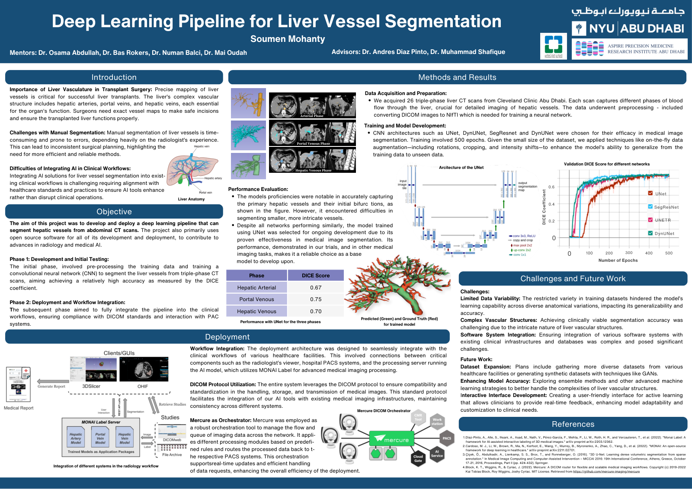
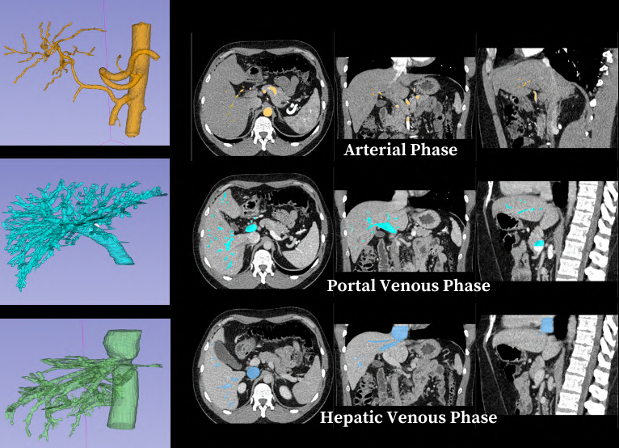
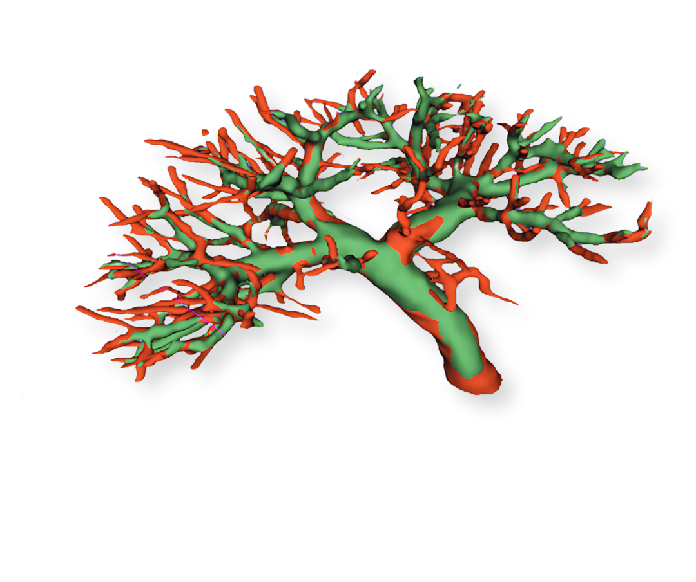
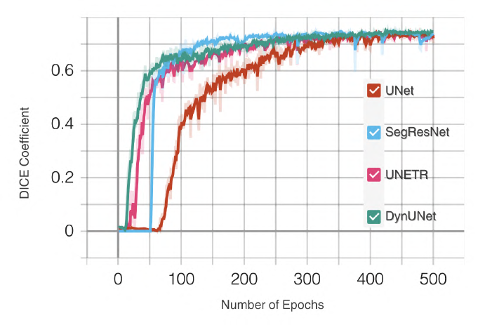
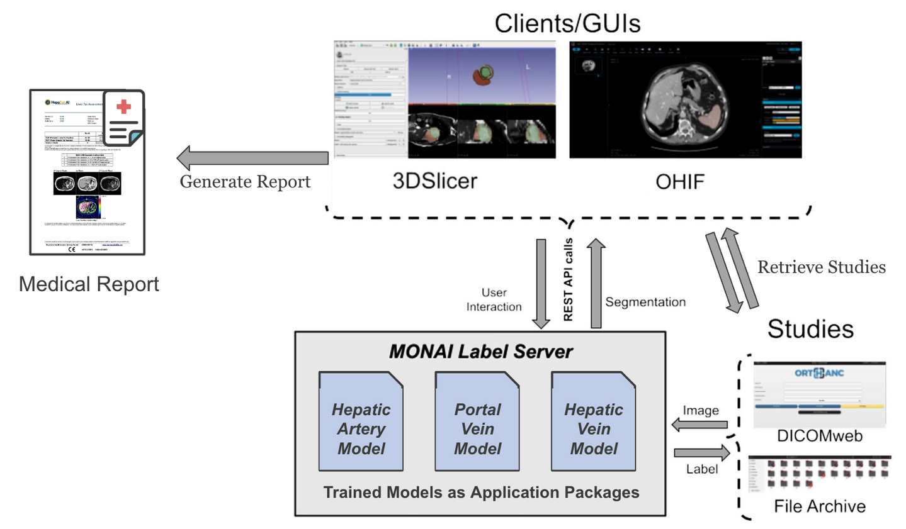
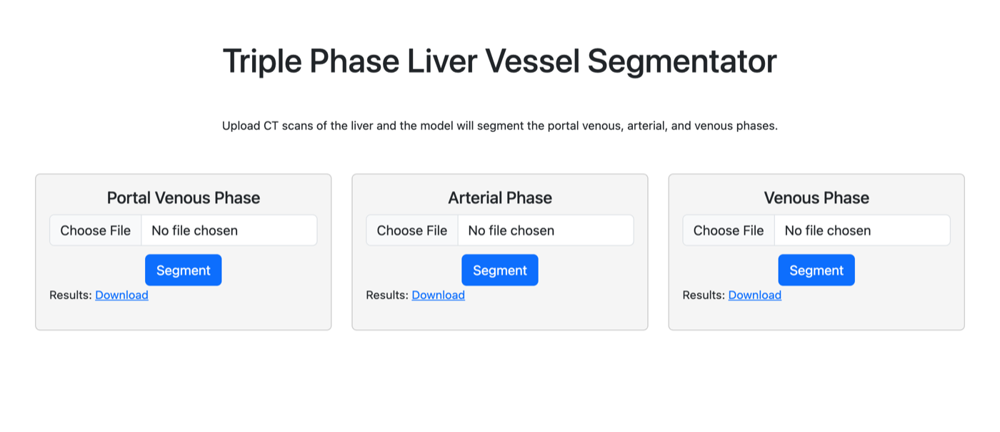

# LiverProject-WebApp
A repo to host the Liver Project Web App, for auto-segmenting CT Scans using Deep Learning

This is the web app from my Computer Science capstone at NYU Abu Dhabi, **Deep Learning Pipeline for Liver Vessel Segmentation** (2023–24). The project trained models to map the hepatic arteries, portal veins and hepatic veins from triple-phase liver CT scans, to help with planning liver transplants, and explored how those models could fit into a hospital's imaging workflow.

**[Read the paper (PDF)](docs/Capstone_Report_Spring_2024.pdf)** · **[View the poster (PDF)](docs/Capstone_Poster.pdf)**

[](docs/Capstone_Poster.pdf)

## Why it matters

Surgeons need an exact map of a liver's vessels before a transplant. Drawing that map by hand is slow and depends on the radiologist's experience, so plans can be inconsistent. This project set out to automate it with open-source tools.

## Results

The dataset was triple-phase CT scans from 26 subjects at Cleveland Clinic Abu Dhabi, with 2 subjects held out for testing. Each phase has its own model.

| Phase | Dice score (UNet) |
| --- | --- |
| Hepatic arterial | 0.67 |
| Portal venous | 0.75 |
| Hepatic venous | 0.70 |

The average Dice score is about 0.71. The models capture the main vessels and their first branches well, and struggle with the finest vessels at the far ends of the tree. I compared four networks, and they performed similarly, so I kept UNet as the base model.

| Network | Best validation Dice |
| --- | --- |
| UNet | 0.7514 |
| SegResNet | 0.7519 |
| UNETR | 0.7452 |
| DynUNet | 0.7563 |



*Vessels segmented in each of the three phases.*



*Model prediction (green) against ground truth (red).*



*Validation Dice over 500 training epochs.*

## How it fits together

The models run on a [MONAI Label](https://github.com/Project-MONAI/MONAILabel) server. The deployment work tested several ways of reaching them: viewers such as 3D Slicer and OHIF, this web app, a command-line version that also writes a report, and DICOM routing through [Mercure](https://github.com/mercure-imaging/mercure).



The web app was the first of these. You upload a scan for a phase, [TotalSegmentator](https://github.com/wasserth/TotalSegmentator) finds the liver, the matching model segments the vessels, and you download the result as NIfTI.



The trained models and MONAI Label apps live in [LiverProject-noGUI](https://github.com/soumen02/LiverProject-noGUI), which is included here as a submodule.

## Run it

You need Docker with enough memory: I tested with 8 CPUs and 16 GB, and the default 2 GB VM in Colima is too small.

```bash
git clone --recursive https://github.com/soumen02/LiverProject-WebApp.git
cd LiverProject-WebApp
docker compose up --build
```

Then open http://127.0.0.1:5055 and upload a contrast CT as `.nii` or `.nii.gz`. The first build takes about 15 minutes and produces about 9 GB of images, and the first upload fetches about 1.4 GB of TotalSegmentator weights. After that, each phase took about 2 minutes on CPU in my tests.

To try it without a scan of your own, upload [`sample/example_ct.nii.gz`](sample). It's a public 3 mm CT that shows the app working end to end, but it isn't what the models were trained on, so expect a nearly empty mask. The Dice scores above come from the capstone's contrast-enhanced data, not from this sample.

To run it without Docker, see [RUNNING.md](RUNNING.md).

## Status

This is a 2023–24 research prototype. It hasn't been clinically validated and isn't for patient care, and it should stay on localhost. The patient data isn't included.

The code up to commit `21fe4ba` (July 2023) was written by hand, and the paper and poster are from 2024. In November 2026 I used Claude Code to get the project running again and to put this page together. [RUNNING.md](RUNNING.md) lists those changes.

## Acknowledgements

Mentors: Dr. Osama Abdullah, Dr. Bas Rokers, Dr. Numan Balci and Dr. Mai Oudah. Advisors: Dr. Andres Diaz Pinto and Dr. Muhammad Shafique. Data from Cleveland Clinic Abu Dhabi.

The sample CT comes from TotalSegmentator (Apache-2.0).
